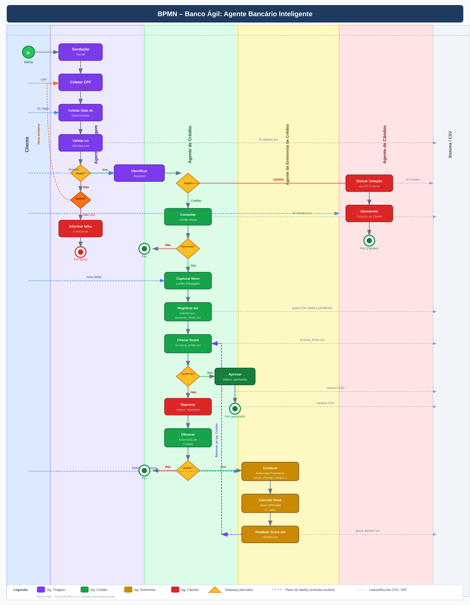

<div align="center">

# 🏦 Agente Bancário Inteligente

### Sistema de Atendimento Bancário Automatizado com Multi-Agentes

*Banco Ágil — do desafio de inovação: triagem, crédito, entrevista e câmbio com IA conversacional.*

[](https://python.org)
[](https://streamlit.io)
[](https://langchain.com)
[](https://groq.com)
[](https://pandas.pydata.org)

</div>

---

## 📑 Índice

- [📖 Sobre o Projeto](#-sobre-o-projeto)
- [✨ Funcionalidades](#-funcionalidades)
- [🏗️ Arquitetura](#️-arquitetura)
- [📂 Estrutura do Projeto](#-estrutura-do-projeto)
- [🧰 Stack Tecnológica](#-stack-tecnológica)
- [🧠 Decisões Técnicas](#-decisões-técnicas)
- [🚀 Começando](#-começando)
- [🛠️ Desafios e Soluções](#️-desafios-e-soluções)

---

## 📖 Sobre o Projeto

**Agente Bancário Inteligente** é um sistema modular de atendimento bancário automatizado que utiliza **Orquestração de Múltiplos Agentes** (Multi-Agent System) para simular o fluxo de operação de um banco digital moderno. O sistema gerencia desde a autenticação segura do cliente até operações complexas de crédito e câmbio.

O objetivo é fornecer uma interface de conversação inteligente onde diferentes especialistas (agentes) colaboram para resolver a necessidade do cliente — persistindo dados, calculando scores de crédito dinamicamente e consultando APIs externas de cotação de moedas, tudo isso mantendo o contexto da conversa.

> 💡 **Diferencial**: cada agente é um especialista com persona e regras próprias, e a troca entre eles (handover) acontece de forma silenciosa, mantendo a memória da conversa via LangChain.

---

## ✨ Funcionalidades

### 🔐 Autenticação
- Verificação de múltiplos fatores (**CPF + Data de Nascimento**) contra a base de correntistas
- Controle de tentativas: bloqueio de acesso após **3 falhas consecutivas**
- Normalização de CPF (`zfill`) para evitar falsos negativos na busca

### 💳 Crédito
- Aprovação de aumento de limite baseada no **score atual** e nas regras de teto por score
- Gravação imediata da aprovação na base de dados
- Log completo das solicitações em CSV

### 📝 Entrevista Financeira
- Entrevista sequencial para entender a **saúde financeira** do cliente
- Recálculo dinâmico do score, permitindo novas chances de crédito

### 💱 Câmbio
- Integração com a **AwesomeAPI** para cotações de USD em tempo real
- Tratamento de falhas de API com respostas seguras

### 🛡️ Resiliência
- Tratamento de exceções para falhas de API, arquivos corrompidos e entradas inválidas

---

## 🏗️ Arquitetura

A arquitetura segue o padrão de **Agentes Especialistas** orquestrados por uma camada central no `app.py`.

### Os 4 Agentes

| Agente | Papel | Responsabilidade |
|---|---|---|
| 🤖 **Triagem** | O "porteiro" | Valida CPF e data de nascimento; bloqueia acessos após 3 tentativas inválidas |
| 💳 **Crédito** | O tomador de decisão | Analisa pedidos de aumento de limite pelo score e pelas regras de teto |
| 📝 **Entrevista** | O analista de perfil | Conduz a entrevista, recalcula o score e libera novas chances de crédito |
| 💱 **Câmbio** | O consultor de mercado | Consulta cotações de USD em tempo real via AwesomeAPI |

### Fluxo de Dados
- **Persistência**: os dados são manipulados via **Pandas** em arquivos CSV, simulando tabelas de banco de dados
- **Memória**: o histórico da conversa é gerenciado pelo **LangChain**, garantindo que os agentes "lembrem" do que foi dito anteriormente

### 🗺️ Documentação Visual (BPMN)
O projeto foi desenhado seguindo as exigências do desafio oficial, utilizando a metodologia **BPMN** para mapear cada gateway de decisão e troca de mensagens.

<div align="center">
  
</div>

---

## 📂 Estrutura do Projeto

```text
agente-bancario-inteligente/
├── agentes/                     # Núcleo de Inteligência (Agentes)
│   ├── __init__.py              # Exportação e orquestração dos agentes
│   ├── agente_triagem.py        # Autenticação e roteamento inicial
│   ├── agente_credito.py        # Lógica de limite e score de crédito
│   ├── agente_entrevista.py     # Coleta de dados e análise de perfil
│   └── agente_cambio.py         # Integração com API de moedas
├── data/                        # Persistência de Dados (Simulação de DB)
│   ├── clientes.csv             # Base principal de correntistas
│   ├── score_limite.csv         # Regras de teto de crédito por score
│   └── solicitacoes_aumento_limite.csv  # Log de pedidos de aumento
├── app.py                       # Orquestrador Central + Interface UI (Streamlit)
├── banco_agil_bpmn.svg          # Modelagem BPMN do fluxo
├── requirements.txt             # Dependências do sistema
├── .gitignore                   # Arquivos ignorados pelo Git
└── README.md                    # Documentação do projeto
```

---

## 🧰 Stack Tecnológica

| Camada | Tecnologia | Uso |
|---|---|---|
| 🧠 **LLM** | Llama 3.3 70B via **Groq** | Raciocínio dos agentes com baixíssima latência |
| 🔗 **Orquestração** | **LangChain** | Handover entre agentes e memória de conversa |
| 🖥️ **Interface** | **Streamlit** | Chat profissional e reativo |
| 📊 **Dados** | **Pandas + CSV** | Simulação de banco de dados relacional |
| 🐍 **Linguagem** | **Python 3.10+** | Lógica de negócio e integrações |
| 🔌 **API Externa** | **AwesomeAPI** | Cotação de moedas em tempo real |

---

## 🧠 Decisões Técnicas

### O Desafio dos Modelos (LLMs)
Durante o desenvolvimento, foram realizados testes extensivos com diferentes modelos via OpenRouter:

| Modelo | Resultado |
|---|---|
| **Gemini 2.0 Flash** | Dificuldade com instruções sistêmicas complexas e alucinações frequentes em gateways de roteamento |
| **Qwen3 VL & GPT-OSS** | Modelos "thinking" potentes, porém lentos demais para o chat e propensos a divagar em tarefas simples |

### A Solução: Groq + Llama 3.3 70B
A escolha final foi o **Llama 3.3 70B rodando no Groq**: a baixíssima latência do Groq combinada com a capacidade de raciocínio do Llama 3.3 permitiu que as trocas entre agentes fossem quase instantâneas — e o modelo se mostrou superior em seguir as "regras de ouro" do sistema (como não pedir documentos ou não sair do contexto de crédito).

---

## 🚀 Começando

### 1️⃣ Preparação

```bash
# Clone o repositório
git clone https://github.com/DevFalconszz/agente-bancario-inteligente.git
cd agente-bancario-inteligente

# Crie e ative o ambiente virtual
python -m venv venv
source venv/bin/activate   # Linux/Mac
# ou
venv\Scripts\activate      # Windows

# Instale as dependências
pip install -r requirements.txt
```

### 2️⃣ Configuração

Crie um arquivo `.env` na raiz do projeto e adicione sua chave:

```env
GROQ_API_KEY=sua_chave_groq_aqui
```

### 3️⃣ Execução

```bash
streamlit run app.py
```

---

## 🛠️ Desafios e Soluções

<details>
<summary><b>1. Alucinação de Rota</b></summary>

O modelo às vezes tentava ir para o Câmbio ao falarmos de "aumentar score".

**Solução:** trava de palavras-chave no código Python do `AgenteCredito`, garantindo que intenções específicas de score sempre forcem o roteamento para Entrevista.

</details>

<details>
<summary><b>2. Persistência de Dados</b></summary>

Garantir que o CSV fosse atualizado sem perder o cabeçalho ou duplicar linhas.

**Solução:** refatoração dos métodos de escrita do Pandas para usar normalização de CPF (`zfill`) antes de qualquer busca ou edição.

</details>

<details>
<summary><b>3. Instrução de Sistema</b></summary>

O modelo tentava criar processos burocráticos (pedir RG/Renda).

**Solução:** refinamento do `SystemMessage` com **Regras Críticas** em caixa alta, instruindo o modelo sobre o que ele **não** deve fazer.

</details>

---

<div align="center">

*Desenvolvido para o desafio Banco Ágil 🏦*

</div>
